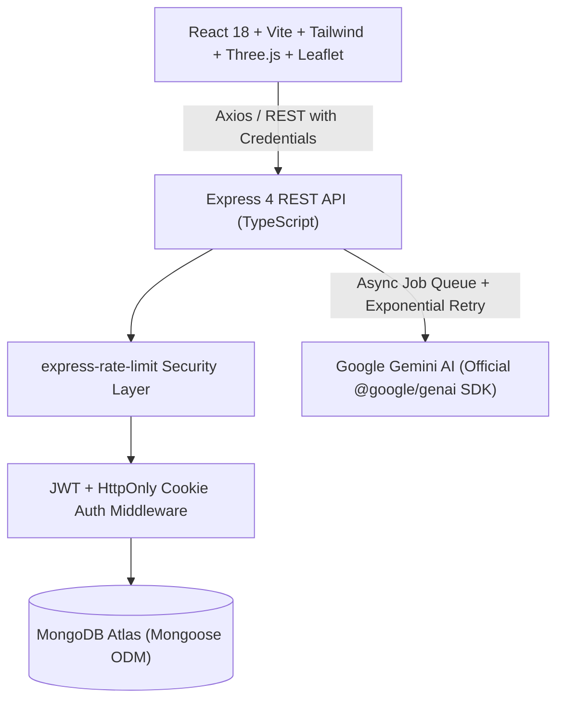

# 🌍 VoyageAI – AI-Powered Smart Travel Planner

[](https://www.typescriptlang.org/)
[](https://reactjs.org/)
[](https://nodejs.org/)
[](https://ai.google.dev/)
[](https://www.mongodb.com/atlas)
[](https://tailwindcss.com/)

> *"Your Journey. Your Budget. Your Perfect Plan."*

VoyageAI is an enterprise-grade full-stack travel planning platform that synthesizes hyper-personalized travel itineraries in seconds using Google's official Gemini AI SDK. Designed with a luxury editorial aesthetic, VoyageAI provides day-by-day schedules, transit logic, interactive Leaflet maps, real-time Recharts financial breakdowns, interactive 3D Three.js globe visualizer, multi-format PDF generation, and public itinerary sharing.

---

## 📑 Table of Contents

1. [Product Architecture](#-product-architecture)
2. [Technology Stack](#-technology-stack)
3. [Key Features](#-key-features)
4. [Project Structure](#-project-structure)
5. [API Specification](#-api-specification)
6. [AI Integration & Prompt Engineering](#-ai-integration--prompt-engineering)
7. [Security & Authentication](#-security--authentication)
8. [Installation & Setup](#-installation--setup)
9. [Running in Development](#-running-in-development)
10. [Production Build & Deployment](#-production-build--deployment)
11. [Troubleshooting & FAQs](#-troubleshooting--faqs)

---

## 🏛 Product Architecture

VoyageAI is implemented as a clean **Modular Monolith** with decoupled frontend and backend domains:



### Architectural Principles
* **Separation of Concerns**: Presentation (React), State Management (Zustand), API Routing (Express), Business Logic (Services), Data Persistence (Mongoose Models), and AI Orchestration (Gemini Engine) reside in isolated modules.
* **Strict Typing**: 100% end-to-end TypeScript compilation with zero `tsc` compiler errors across both client and server applications.
* **Resilient AI Pipeline**: Generation requests run through an asynchronous job queue model (`pending` → `processing` → `completed` | `failed`) with automatic exponential backoff retry and Zod schema validation.
* **Financial Integrity**: Algorithmic recalculation of expenses ensuring hotel, meal, transport, and tour budgets strictly balance.

---

## 💻 Technology Stack

### Frontend
* **Core**: React 18, TypeScript, Vite
* **Styling**: Tailwind CSS, CSS Custom Properties, Glassmorphic UI Design System
* **3D Visuals**: Three.js (custom canvas-driven atmospheric Earth sphere with starfield)
* **Animations**: Framer Motion
* **Maps**: Leaflet, React Leaflet (custom HTML/SVG marker clusters with popups)
* **Data Visualization**: Recharts (Interactive Donut charts, category expense comparisons)
* **State Management**: Zustand with persistent storage
* **Form Validation**: React Hook Form, Zod schemas
* **Document Export**: jsPDF + html2canvas
* **Icons**: Lucide React

### Backend
* **Runtime**: Node.js v20+ / v22+
* **Framework**: Express.js with TypeScript
* **Database**: MongoDB Atlas via Mongoose ODM
* **Generative AI**: Official `@google/genai` SDK (`gemini-3.8-flash` / `gemini-2.0-flash`)
* **Authentication**: JSON Web Tokens (JWT) inside secure `HttpOnly` cookies, bcryptjs (12 rounds)
* **Validation**: Zod schema validation middleware
* **Security**: Helmet, CORS with strict origin validation, express-rate-limit

---

## ✨ Key Features

### 1. 9-Step Interactive Trip Planning Wizard
* **Step 1: Destination** – Autocomplete & curated destinations (Tokyo, Paris, Bali, Rome, etc.).
* **Step 2: Dates & Duration** – Departure and return date picker with duration calculation.
* **Step 3: Starting Location** – Home origin and outbound departure airport/city.
* **Step 4: Group & Companions** – Solo, Couple, Family, Friends, Business.
* **Step 5: Budget Tier & Limit** – Backpacker, Moderate, Luxury, or Ultra-VIP with numerical budget limit.
* **Step 6: Travel Style & Interests** – Art, Architecture, Nature, Gastronomy, Nightlife, Adventure, History.
* **Step 7: Accommodation Preference** – Boutique hotels, hostels, 5-star resorts, private villas, Airbnbs.
* **Step 8: Transport Preference** – Public transit, rental car, private driver, walking-friendly.
* **Step 9: Dietary & Special Notes** – Halal, Vegan, Gluten-free, accessibility requirements.

### 2. Autonomous Gemini Itinerary Engine
* Multi-day schedule generation structured by time slots: **Morning**, **Afternoon**, and **Evening**.
* Geographical clustering to minimize transit times and avoid backtracking.
* Handpicked accommodations with estimated cost per night, ratings, and amenity highlights.
* Curated restaurant recommendations categorized by cuisine and price tier.
* Real-time polling with animated progress checkpoints (Analyzing preferences → Curating accommodations → Generating daily schedules → Calculating budget).

### 3. Interactive Trip Dashboard & Tools
* **Overview Tab**: Trip synopsis, quick stats, key alerts, and trip weather recommendations.
* **Daily Schedule Tab**: Expandable timeline cards with exact timings, descriptions, locations, and booking tips.
* **Hotels & Dining Tabs**: Interactive cards with direct address details and pricing breakdown.
* **Interactive Leaflet Map**: Day-filtered attractions, restaurants, and hotels plotted with custom SVG markers.
* **Budget Analytics Tab**: Recharts donut chart comparing predicted spend vs user threshold.
* **Packing & Safety Tab**: Destination-specific emergency numbers, cultural etiquette, and checklist items.
* **PDF Export**: Print-ready multi-page travel dossier generated directly in-browser.
* **Public Trip Sharing**: Unique shareable link with secure view-only access.

---

## 📁 Project Structure

```
voyage-ai/
├── backend/
│   ├── src/
│   │   ├── config/
│   │   │   ├── constants.ts       # Centralized timeouts, cookie names, limits
│   │   │   ├── db.ts              # MongoDB Atlas connection manager with retry
│   │   │   └── env.ts             # Zod-validated environment schema
│   │   ├── middleware/
│   │   │   ├── auth.middleware.ts # JWT authentication & cookie extractor
│   │   │   ├── error.middleware.ts# Global error handler with RFC 7807 formatting
│   │   │   ├── rateLimit.middleware.ts # Security rate limiters
│   │   │   └── validate.middleware.ts  # Zod schema validation
│   │   ├── models/
│   │   │   ├── GenerationJob.model.ts  # Asynchronous AI job tracking
│   │   │   ├── Itinerary.model.ts      # Multi-day schedule & budget schema
│   │   │   ├── Trip.model.ts           # User trip inputs and preferences
│   │   │   └── User.model.ts           # User accounts & preferences
│   │   ├── modules/
│   │   │   ├── ai/                # Prompt builders, Gemini SDK call, retry logic
│   │   │   ├── auth/              # Registration, Login, Logout, Passwords
│   │   │   ├── itineraries/       # CRUD operations, sharing, export
│   │   │   ├── trips/             # Trip lifecycle management
│   │   │   └── users/             # Profile management & settings
│   │   ├── shared/                # Standardized errors and API response helpers
│   │   ├── utils/                 # Password hashing, token signers, budget math
│   │   ├── app.ts                 # Express application definition
│   │   └── server.ts              # Server startup & graceful shutdown
│   ├── .env                       # Backend environment configuration
│   ├── package.json
│   └── tsconfig.json
│
├── frontend/
│   ├── src/
│   │   ├── components/
│   │   │   ├── globe/             # Three.js 3D Earth canvas component
│   │   │   ├── itinerary/         # ActivityCard, HotelCard, RestaurantCard, Timeline
│   │   │   ├── layout/            # Navbar, Footer, PageWrapper
│   │   │   ├── map/               # Leaflet React interactive map
│   │   │   ├── trip-wizard/       # Multi-step trip generator steps 1-9
│   │   │   └── ui/                # Button, Input, Modal, Badge, ProgressBar
│   │   ├── hooks/                 # Custom React hooks (useAuth, useTrip)
│   │   ├── pages/                 # 16 Production pages
│   │   │   ├── auth/              # Login, Register, ForgotPassword, ResetPassword
│   │   │   ├── dashboard/         # User dashboard & analytics
│   │   │   ├── trips/             # CreateTrip, AIProgress, ItineraryResults, MyTrips
│   │   │   ├── Home.tsx           # Editorial landing page with 3D Globe
│   │   │   ├── Explore.tsx        # Destination discovery
│   │   │   ├── SharedTrip.tsx     # Public read-only itinerary page
│   │   │   └── Profile.tsx        # User settings
│   │   ├── services/              # Axios API service client
│   │   ├── store/                 # Zustand state stores
│   │   ├── types/                 # Shared TypeScript interfaces
│   │   ├── App.tsx                # React Router setup
│   │   ├── globals.css            # Tailwind & glassmorphism utilities
│   │   └── main.tsx               # Entry point
│   ├── .env                       # Frontend environment configuration
│   ├── package.json
│   ├── vite.config.ts
│   └── tailwind.config.js
│
└── README.md
```

---

## 🔌 API Specification

All endpoints are prefixed with `/api/v1`.

### Authentication Endpoints
| Method | Endpoint | Description | Auth Required |
|---|---|---|---|
| `POST` | `/auth/register` | Register new user account | No |
| `POST` | `/auth/login` | Authenticate user & set HttpOnly cookie | No |
| `POST` | `/auth/logout` | Clear auth cookie | Yes |
| `GET` | `/auth/me` | Fetch authenticated user session | Yes |
| `POST` | `/auth/forgot-password` | Generate password reset token | No |
| `POST` | `/auth/reset-password` | Set new password with valid token | No |

### Trip Management Endpoints
| Method | Endpoint | Description | Auth Required |
|---|---|---|---|
| `POST` | `/trips` | Create new travel requirement profile | Yes |
| `GET` | `/trips` | List user trips with pagination | Yes |
| `GET` | `/trips/:id` | Retrieve single trip details | Yes |
| `PATCH` | `/trips/:id` | Update trip preferences | Yes |
| `DELETE` | `/trips/:id` | Remove a trip and its itineraries | Yes |

### AI Generation & Itinerary Endpoints
| Method | Endpoint | Description | Auth Required |
|---|---|---|---|
| `POST` | `/ai/generate` | Dispatch async Gemini itinerary generation job | Yes |
| `GET` | `/ai/status/:jobId` | Poll status of generation job (`pending`, `completed`) | Yes |
| `GET` | `/itineraries/trip/:tripId` | Fetch latest generated itinerary for a trip | Yes |
| `POST` | `/itineraries/:id/share` | Generate public share token | Yes |
| `GET` | `/itineraries/shared/:token` | View public shared itinerary | No |

---

## 🤖 AI Integration & Prompt Engineering

VoyageAI integrates directly with Google's `@google/genai` SDK using `gemini-3.8-flash` (or `gemini-2.0-flash`).

### Prompt Engineering Architecture:
1. **Context Construction**: Formats the traveler's exact inputs (origin, destination, dates, budget limit, companion type, dietary rules, and interests).
2. **Strict JSON Schema**: Instructs Gemini to output a pure, parseable JSON payload matching `geminiItineraryResponseSchema`.
3. **Budget Mathematics**: Mandates that the sum of accommodation, dining, activities, and transport equals the total estimated cost.
4. **Transit Logic**: Dictates that sequential activities on any given day must be geographically proximal to minimize commute time.
5. **Fallback & Retry**: Incorporates an automated retry wrapper (`ai.retry.ts`) with exponential backoff if the AI payload fails JSON or Zod schema validation.

---

## 🔒 Security & Authentication

* **HttpOnly Cookies**: Session tokens (`voyage_token`) are transmitted exclusively via `SameSite: Lax`, `HttpOnly` cookies, shielding them from XSS attacks.
* **Password Hashing**: Passwords are encrypted with `bcryptjs` using a cost factor of 12 rounds.
* **Strict Validation**: All incoming request bodies and query parameters are parsed through Zod schemas before reaching controllers.
* **CORS & Headers**: Helmet sets strict Content Security Policies, while CORS allows only authorized client origins with credentials.
* **API Rate Limiting**: Express rate limiters protect against brute-force authentication attempts and AI abuse.

---

## 🚀 Installation & Setup

### Prerequisites
* **Node.js**: v20 or v22 installed
* **Package Manager**: npm or pnpm
* **MongoDB**: A MongoDB Atlas cluster connection string
* **Gemini API Key**: From [Google AI Studio](https://aistudio.google.com/)

### 1. Clone & Configure
```bash
git clone https://github.com/your-username/voyage-ai.git
cd voyage-ai
```

### 2. Configure Backend Environment
Edit `backend/.env`:
```env
PORT=5001
NODE_ENV=development
MONGODB_URI=mongodb+srv://<username>:<password>@cluster0.rdzasec.mongodb.net/voyageai?retryWrites=true&w=majority
JWT_SECRET=voyageai_super_secret_jwt_key_2024_production_ready_32chars
JWT_EXPIRES_IN=7d
GEMINI_API_KEY=your_gemini_api_key_here
GEMINI_MODEL=gemini-3.8-flash
CLIENT_URL=http://localhost:5173
COOKIE_DOMAIN=localhost
```

### 3. Configure Frontend Environment
Edit `frontend/.env`:
```env
VITE_API_URL=http://localhost:5001/api/v1
```

---

## 🛠 Running in Development

### Start Backend API Server
```bash
cd backend
npm run dev
# Server will listen on http://localhost:5001
```

### Start Frontend Dev Server
```bash
cd frontend
npm run dev
# Client will be available at http://localhost:5173
```

Open your browser to `http://localhost:5173` to explore VoyageAI!

---

## 📦 Production Build & Deployment

### Build Backend
```bash
cd backend
npm run build
# Compiles TypeScript into production-ready JavaScript in backend/dist/
```
Start in production:
```bash
npm start
```

### Build Frontend
```bash
cd frontend
npm run build
# Generates minified production assets in frontend/dist/
```

### Deployment Guidelines:
* **Frontend**: Deploy `frontend/dist` to **Vercel** or **Cloudflare Pages**. Set `VITE_API_URL` to your production backend domain.
* **Backend**: Deploy `backend` to **Render**, **Railway**, or **AWS ECS**. Provide the environment variables listed in `backend/.env`.
* **Database**: MongoDB Atlas with Network Access configured (whitelist production server IP or `0.0.0.0/0`).

---

## ❓ Troubleshooting & FAQs

* **MongoDB Atlas Connection Timeout / EACCES**:
  Ensure your current public IP address is whitelisted in MongoDB Atlas under **Network Access** > **Add IP Address** (or select `Allow Access From Anywhere: 0.0.0.0/0` during development).
* **Gemini API Model Deprecation**:
  If using an existing key, the backend defaults to `gemini-3.8-flash`. You can configure any available Gemini model in `backend/.env` under `GEMINI_MODEL`.
* **CORS Credentials in Browser**:
  Verify that `CLIENT_URL` in `backend/.env` exactly matches your frontend URL (including protocol and port, e.g. `http://localhost:5173`).

---

## 📄 License
This project is licensed under the MIT License.
